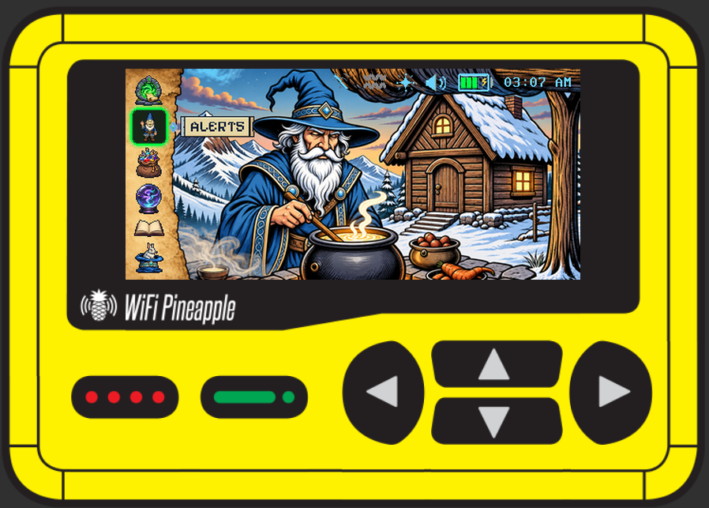
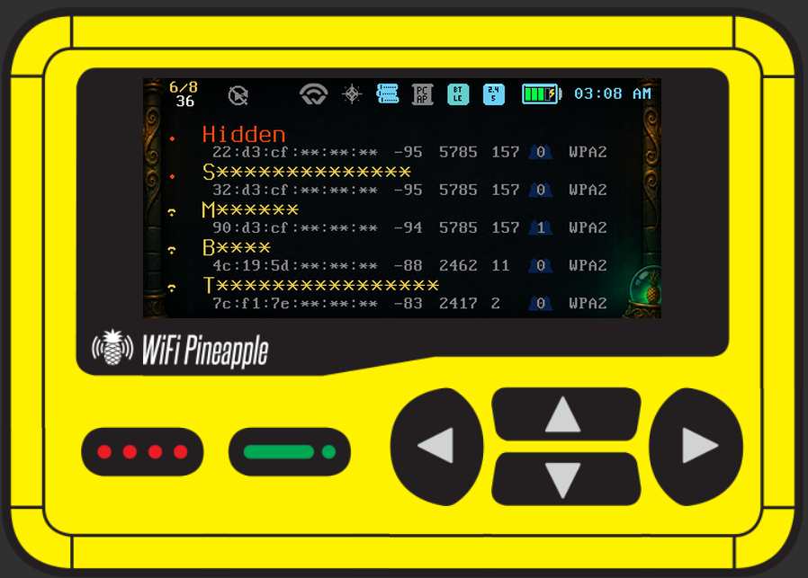
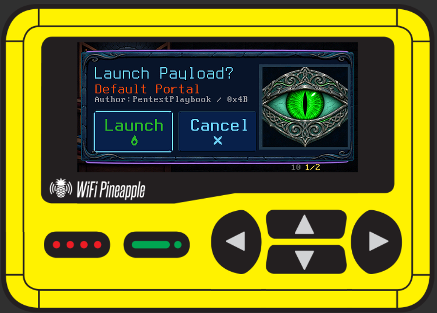
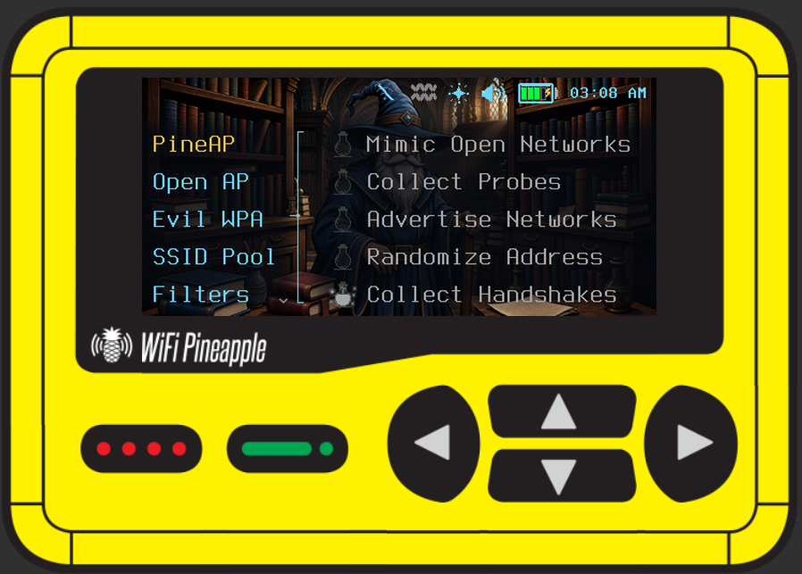
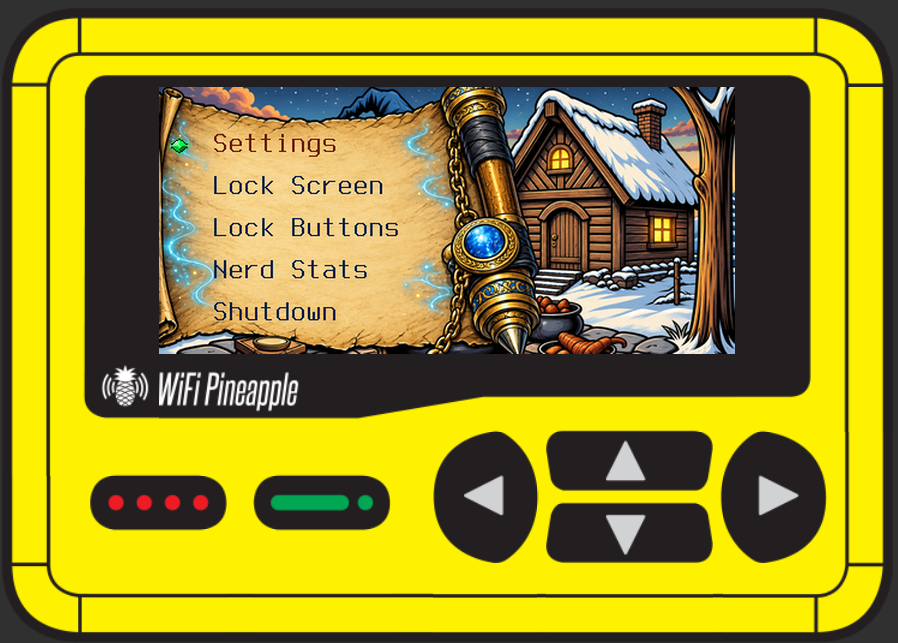
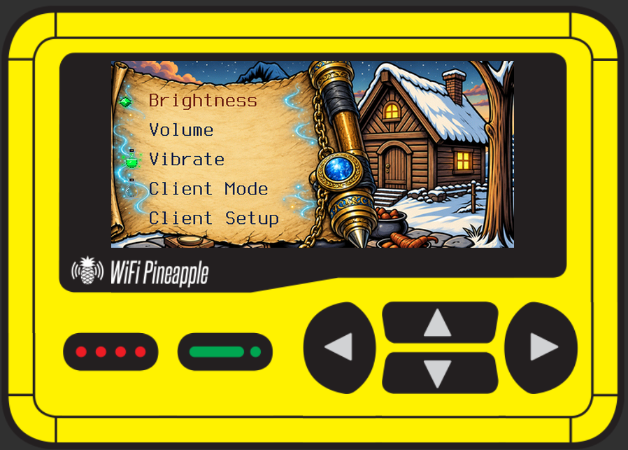
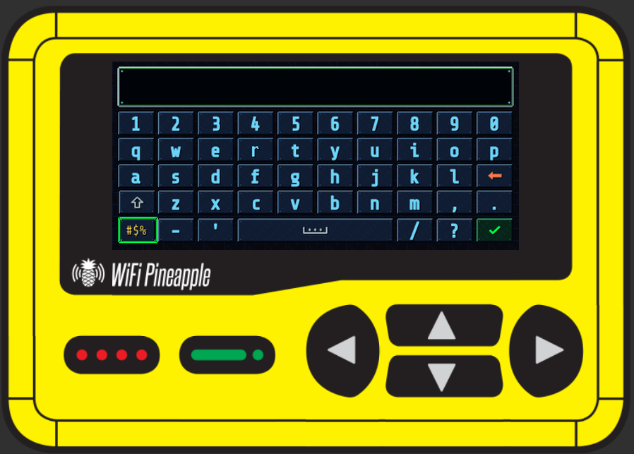
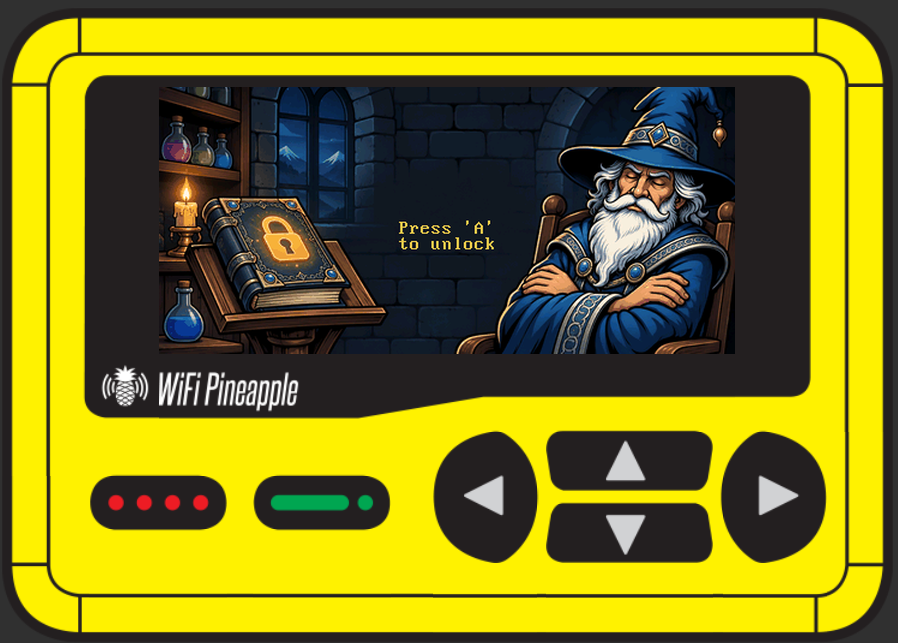

# EthernetWizard-Pager-Theme
Wifi Pineapple Pager Ethernet Wizard!! v2 is here, rebuilt for Pager firmware 2.0.0 :)

## v2 (firmware 2.0.0)
Download and unzip **EthernetWizard_v2.zip**
Place the **ethernet_wizard** folder into your themes folder on your pager (`/root/themes/`), then pick it under Settings → General → Theme!!

Coming from v1? Switch to the built in wargames theme first, delete the old EthernetWizard folder, then drop in the new one.

What's new in v2:
- New main menu rail with sharper icons, the name of the icon you're on shown beside it, and a glowing green rune marking your spot
- New Pager Portal scenes: a PC with a portal pouring out of the screen, the wizard brewing potions for Payloads, and browsing on a crystal screen PC for Themes
- All the original v1 art remastered, crisper and tuned for the Pager screen
- Mana Flask on/off switch that fills with glowing green mana when it's on
- Arcane eye launch animation that opens and closes while your payload launches
- Green gem cursor, green potion payload marker, crystal ball folder icon and redrawn small icons
- Orb loading spinner with mist swirling inside
- Rune stone keyboards
- Candlelit Recon list, green glow on selected alerts, and solid lock screens you can actually see
- EthernetWizard Lab QR code under Settings → Help (page 2)
- All the new firmware 2.0.0 screens styled to match

v2 only works on firmware 2.0.0. If you're still on firmware 1.0.x, grab v1 below.

## v1 (firmware 1.0.x)
Wifi Pineapple Pager Ethernet Wizard!! This is the first custom theme ive ever made, i hope you enjoy!
Download and upzip the Ethernetwizard.zip
Place the Ethernetwizard folder into your themes folder on your pager!! 

If you need a guided walkthrough dont feel bad ive linked the absolute legend The Talking Sasquatch below helping you step by step ;)
https://youtu.be/jQi02L46kvA?si=V45inet5OCksReA1&t=356

