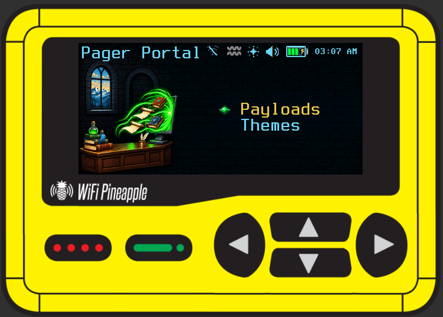
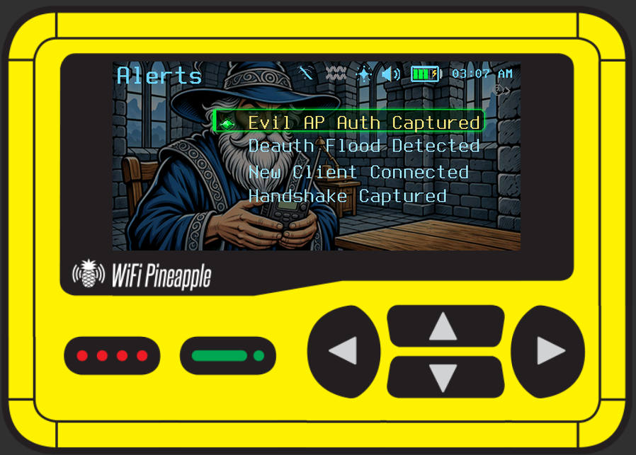
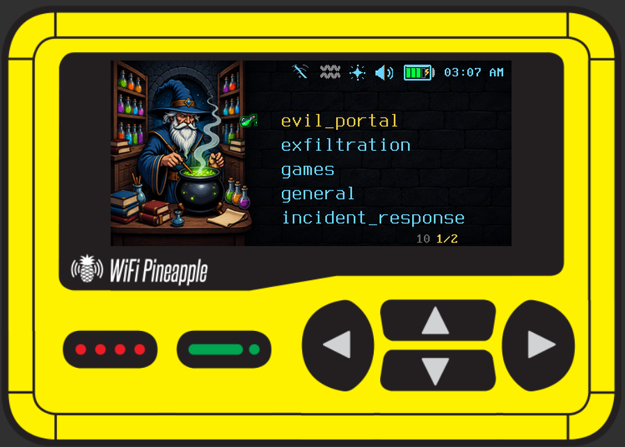
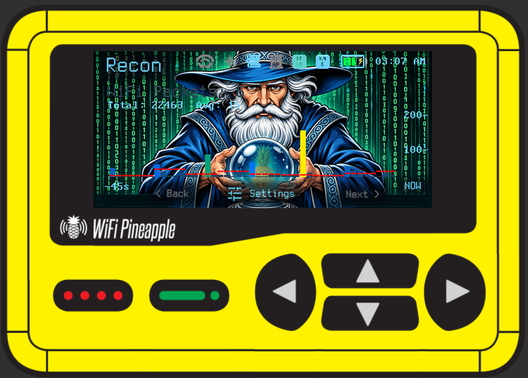
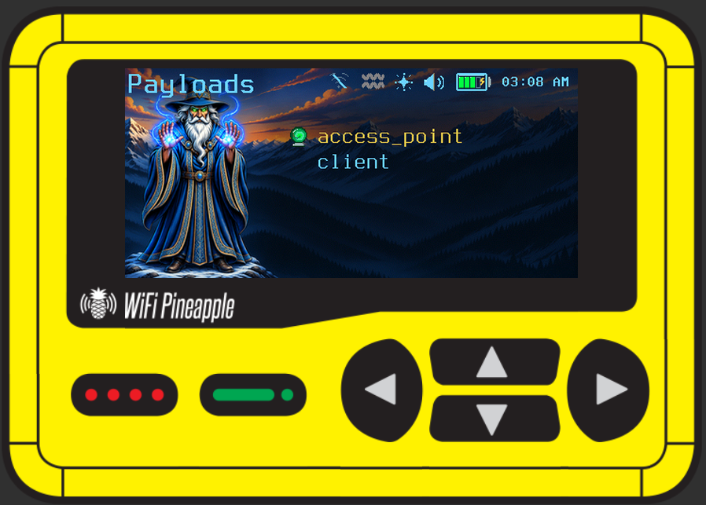
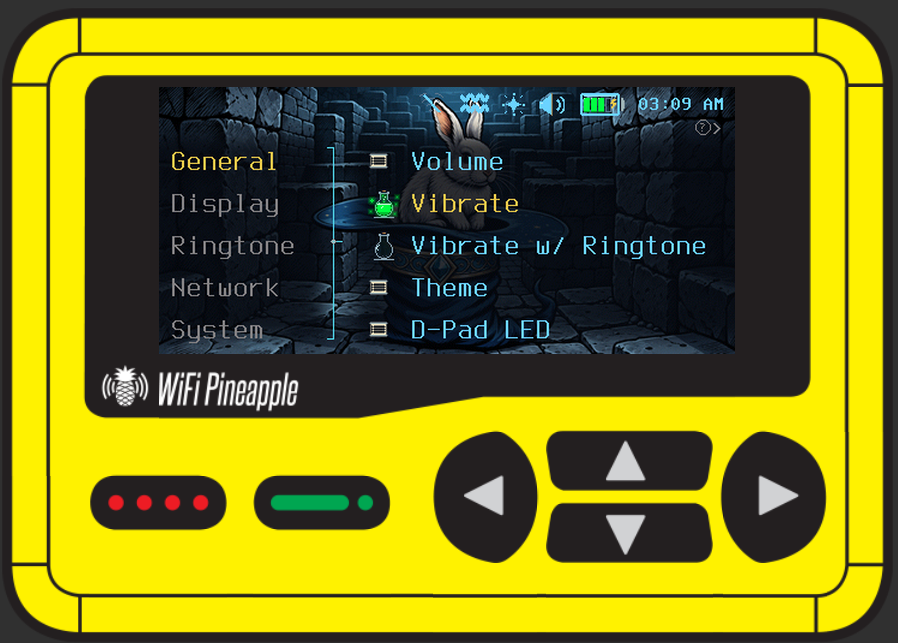
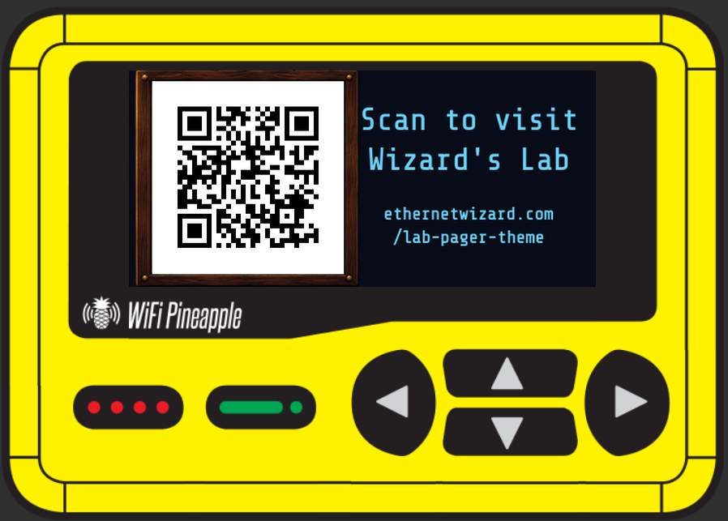

# EthernetWizard Pager Theme

A wizard-themed interface for the Hak5 WiFi Pineapple Pager, with custom pixel art, menus, and animations. Check your Pager firmware before choosing a download.

- **Firmware 2.0.0 — theme v2:** [Download EthernetWizard_v2.zip](https://github.com/EthernetWizard/EthernetWizard-Pager-Theme/releases/download/v2/EthernetWizard_v2.zip) · [v2 release notes](https://github.com/EthernetWizard/EthernetWizard-Pager-Theme/releases/tag/v2). The ZIP contains `ethernet_wizard/`.
- **Firmware 1.0.0 — original theme v1:** [Download EthernetWizard_v1.zip](https://github.com/EthernetWizard/EthernetWizard-Pager-Theme/releases/download/v1/EthernetWizard_v1.zip) · [v1 release notes](https://github.com/EthernetWizard/EthernetWizard-Pager-Theme/releases/tag/v1). The ZIP contains `EthernetWizard/`.

The v2 release requires firmware 2.0.0. The v1 release specifies 1.0.0; compatibility with other 1.0.x versions is unconfirmed.

## Install or upgrade

1. Download and unzip the asset for your firmware.
2. If moving from v1 to v2, switch to the built-in `wargames` theme first. Back up the old `EthernetWizard` folder before removing it from the Pager's themes directory.
3. Copy the extracted folder—not the ZIP or a folder containing it—into `/root/themes/` on the Pager. See [Hak5's file transfer guide](https://docs.hak5.org/wifi-pineapple-pager/connecting-to-the-wifi-pineapple-pager/ssh-and-the-wifi-pineapple-pager). Check that `theme.json` is directly inside the copied folder: `/root/themes/ethernet_wizard/theme.json` for v2 or `/root/themes/EthernetWizard/theme.json` for v1.
4. On the Pager, go to **Settings → General → Theme** and select the installed theme.

## Screenshots

[Original v1 screenshots and walkthrough](#v1-original)

### Dashboard

### Pager Portal

### Alerts

### Payloads

### Recon

### Recon list

### Recon payloads

### Launch payload

### PineAP

### Settings

### Power menu

### Quick settings

### Keyboard

### Lock screen

### EthernetWizard Lab QR code

## What's new in v2

- New main menu rail with sharper icons, the name of the icon you're on shown beside it, and a glowing green rune marking your spot
- New Pager Portal scenes: a PC with a portal pouring out of the screen, the wizard brewing potions for Payloads, and browsing on a crystal screen PC for Themes
- All the original v1 art remastered, crisper and tuned for the Pager screen
- Mana Flask on/off switch that fills with glowing green mana when it's on
- Arcane eye launch animation that opens and closes while your payload launches
- Green gem cursor, green potion payload marker, crystal ball folder icon and redrawn small icons
- Orb loading spinner with mist swirling inside
- Rune stone keyboards
- Candlelit Recon list, green glow on selected alerts, and solid lock screens you can actually see
- EthernetWizard Lab QR code under Settings → Help (page 2)
- All the new firmware 2.0.0 screens styled to match

## v1 original

Original artwork and walkthrough, kept for reference. The video is for v1.

[Watch the original v1 installation walkthrough (YouTube, 5:56)](https://youtu.be/jQi02L46kvA?t=356)

